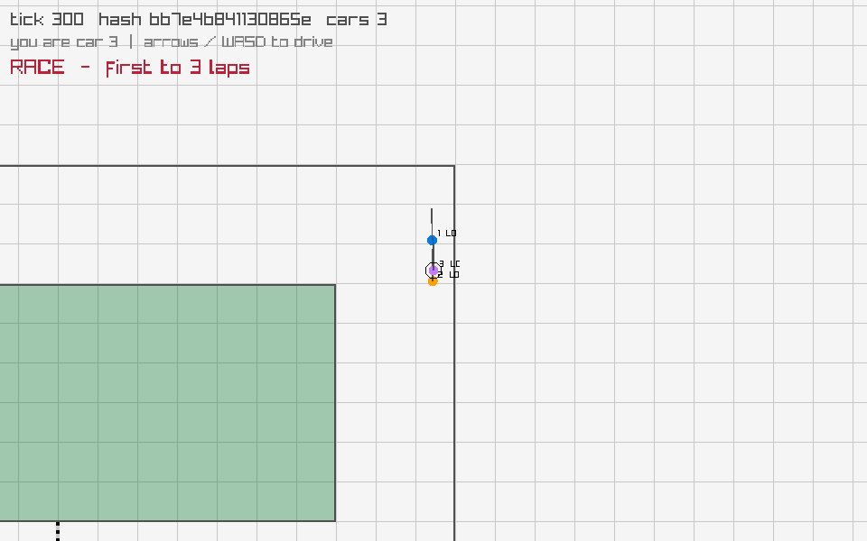

# statesync-racer

[](https://github.com/fff132bb-lab/statesync-racer/actions/workflows/ci.yml)

A small multiplayer racing game built around **server-authoritative state sync**.

The server owns the simulation. It steps every car at a fixed tick rate and
broadcasts the full world snapshot to all connected clients each tick. Clients
only render what the server says.

## What works today

- `racer_server`: listens on a TCP port, gives each connected client a car,
  steps a deterministic simulation at a fixed tick rate, and broadcasts every
  car's position and velocity plus a state hash each tick. Each car follows
  its client's input; clients that send none get a seeded bot driver.
  Handles clients joining and leaving at any time.
- `racer_client`: connects, decodes each snapshot, and prints it. With
  `--steer` and `--throttle` it also drives its car.
- `racer_viewer` (optional, raylib): renders the race live, follows your car,
  and drives it with the arrow keys or WASD.
- `sim_test`: offline checks that bots lap the track, cars never leave it,
  and identical inputs give identical hashes.
- `racer_replay`: re-simulates a recorded race and checks the state hash on
  every tick, reporting the first tick that diverges.
- `src/common/sim.hpp`: the simulation. Integer-only state (micrometres,
  micrometres per tick, 16 headings), so the same inputs give bit-identical
  results on any machine, plus a 64-bit FNV-1a hash of the full world state.
- `src/common/racelog.hpp`: race log writer and replayer.
- `src/common/protocol.hpp`: the snapshot format shared by server and client.

Wire format, one line per tick (text for now so it's easy to inspect with `nc`):

```
PHASE <lobby|countdown|race|finished> ...
STATE <tick> <hash> <count> [<id> <x> <y> <vx> <vy> <lap>]...
```

Clients send their controls the same way. `steer` is -1, 0 or 1 and
`throttle` is 0..255; the server applies the latest line on every tick until
a new one arrives, and records it in the race log so replays stay exact.

```
INPUT <steer> <throttle>
```

## Viewer



This frame was rendered by `racer_viewer` in CI (under Xvfb) against a live
server with three connected clients, mid-race. Press Enter in the lobby to
ready up; the race starts after a countdown once every player is ready, and
the first car to finish the lap target wins. Build it with:

```sh
cmake -S . -B build -DRACER_VIEWER=ON   # fetches and builds raylib 5.5
cmake --build build -j
./build/racer_viewer 127.0.0.1 7777
```

On Linux raylib needs the X11 and OpenGL dev packages
(`libx11-dev libxrandr-dev libxinerama-dev libxcursor-dev libxi-dev libgl1-mesa-dev`).

## Record and replay

The server can log everything needed to rebuild a race: who joined or left on
which tick, every input applied, and the state hash after each tick.

```sh
./build/racer_server 7777 20 --seed 42 --record race.log --max-ticks 200
# connect a client or two, then:
./build/racer_replay race.log
# OK: 200 ticks replayed, all hashes match
```

If anything in the simulation stops being deterministic, or a log is changed,
the replay stops at the first bad tick:

```
DESYNC at tick 30: expected 34222ba6cf51870e, got b81440728636157e (31 ticks checked)
```

`racer_replay` exits 0 when every hash matches, 1 on a desync, and 2 on a
malformed log, so it can gate CI.

Race log format, one record per line:

```
RACELOG 1 <seed>
J <tick> <id>                 car joined
L <tick> <id>                 car left
I <tick> <id> <steer> <thr>   input applied on that tick
H <tick> <hash>               state hash after that tick
```

## Build

Needs a C++17 compiler on Linux or macOS.

With CMake:

```sh
cmake -B build
cmake --build build
```

Or directly:

```sh
mkdir -p build
c++ -std=c++17 -O2 src/server/main.cpp -o build/racer_server
c++ -std=c++17 -O2 src/client/main.cpp -o build/racer_client
c++ -std=c++17 -O2 src/tools/replay.cpp -o build/racer_replay
```

## Run

In one terminal, start the server (port 7777, 20 ticks per second):

```sh
./build/racer_server 7777 20
```

Options: `--seed N` (bot driver seed), `--record FILE` (write a race log),
`--max-ticks N` (stop after N ticks), `--laps N` (laps to win, default 3),
`--countdown TICKS` (default 3 s), `--min-players N` (default 1).

In one or more other terminals, start clients:

```sh
./build/racer_client 127.0.0.1 7777
```

Each client prints lines like:

```
tick 79 hash b43b7c3381244bad: 1 car(s)  [car 2 pos=(4.12, 9.48) vel=(-12.20, 13.18)]
```

Pass a third argument to stop after N snapshots, for example
`./build/racer_client 127.0.0.1 7777 10`.

Stop the server with Ctrl+C.

## Smoke test

```sh
./scripts/smoke_test.sh build
```

Starts a recording server, connects two clients, and checks that both got
snapshots, that a driving client's input reaches the simulation, that a
client's hash matches the server log, that the log replays
cleanly, and that a log with one tampered input is caught at the right tick.

## Roadmap

- [x] Deterministic integer physics and per-tick state hashes
- [x] Input logging and headless replay for desync detection
- [x] Client input (steer, throttle) sent to the server
- [x] CI: build with g++ and clang++, run the smoke test
- [x] raylib viewer with keyboard driving, rendered in CI
- [x] Lobby with ready-up and countdown, track walls, laps and a winner
- Results screen and rematch without restarting the server
- Brake and boost inputs
- Client-side check of server hashes and resync on mismatch
- Binary wire format and UDP transport
- Sharding races across multiple server nodes

## License

MIT
